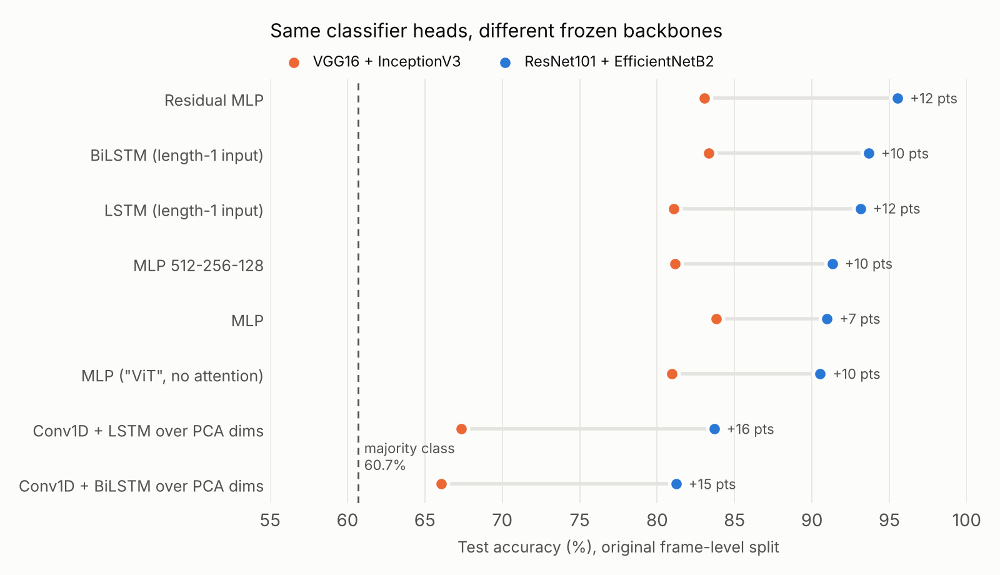
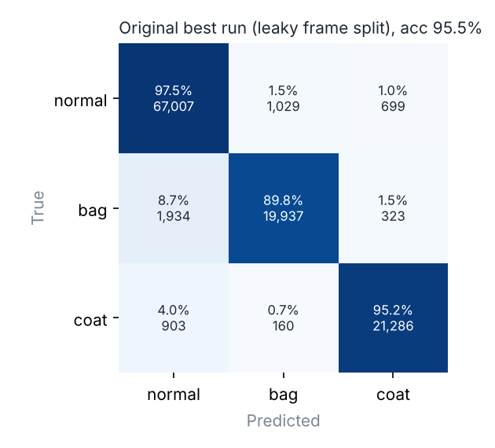

# Gait Condition Classification on CASIA-B

Classify the **walking condition** in a gait silhouette (normal walk, carrying a bag, or wearing
a coat) using frozen ImageNet CNN features, PCA and a small classifier head. This repository
is a cleaned-up, reproducible version of our B.Tech final-year project, with the evaluation
problems of the original notebooks fixed.



> **Status:** the numbers in the figure above come from the original notebooks, which split
> the data *by frame*. Frames from the same walking sequence appear in both train and test,
> so those accuracies are optimistic. The pipeline in `src/` uses a subject-disjoint split;
> its results go in [Results on a subject-disjoint split](#results-on-a-subject-disjoint-split)
> once the full run finishes.

## TL;DR

| | |
|---|---|
| **Task** | 3-class frame classification: `nm` (normal), `bg` (bag), `cl` (coat) |
| **Data** | CASIA-B silhouettes, 124 subjects × 11 view angles, 566,386 frames |
| **Method** | Frozen ResNet101 + EfficientNetB2 features → StandardScaler → PCA → MLP |
| **Original result** | 95.5% accuracy, 0.942 balanced accuracy (frame split, leaky); majority-class baseline 60.7% |
| **Main finding** | The backbone matters far more than the head: the same heads score 7-16 points higher on ResNet+EfficientNet features than on VGG+Inception features |

## Why this problem

Gait recognition identifies people by how they walk, but carried objects and clothing change the
silhouette and are the main reason cross-condition recognition accuracy drops. Detecting the
condition first is useful on its own (e.g. flagging carried objects) and as a routing step
before identity matching.

## Method

```
silhouette PNG ─► pad to square, resize 224 ─► frozen ResNet101 ─┐
                                              frozen EfficientNetB2 ┴► concat (3456-d)
   ─► StandardScaler + PCA (fit on train subjects only) ─► classifier head ─► nm / bg / cl
   ─► average frame probabilities per sequence ─► sequence prediction
```

* **Backbones** are used as fixed feature extractors with global average pooling; nothing is
  fine-tuned. VGG16 + InceptionV3 is kept as a comparison.
* **Heads**: logistic regression, a linear softmax layer, an MLP and a residual MLP (the best
  head from the original work).
* **Evaluation**: accuracy, balanced accuracy, macro-F1, per-class recall, per-angle accuracy,
  the majority-class baseline, and sequence-level accuracy.

## Results

### Original notebooks (frame-level split, leaky)

Best run: ResNet101 + EfficientNetB2 features, PCA to 768 dims, residual MLP head.

| Metric | Value |
|---|---|
| Accuracy | 95.5% |
| Balanced accuracy | 94.2% |
| Weighted F1 | 0.955 |
| Recall: normal / bag / coat | 97.5% / 89.8% / 95.2% |
| Majority-class baseline | 60.7% |



Bag is the hardest class: 8.7% of bag frames are predicted as normal. A bag changes a small part
of the silhouette, and at some angles it is hidden behind the body.

All 18 original runs, with what each model actually is, are in
[`results/original_frame_split/all_runs.csv`](results/original_frame_split/all_runs.csv).

### Results on a subject-disjoint split

Train on subjects 001-062, validate on 063-074, test on 075-124. No subject appears in more
than one split.

| Backbones | Head | Frame acc | Balanced acc | Macro-F1 | Sequence acc |
|---|---|---|---|---|---|
| ResNet101 + EffNetB2 | residual MLP | _pending_ | | | |
| ResNet101 + EffNetB2 | logistic regression | _pending_ | | | |
| VGG16 + InceptionV3 | residual MLP | _pending_ | | | |
| Same features, frame split (leak check) | residual MLP | _pending_ | | | |

Running `--split frame` on the same features shows how much of the original number came from
the leak.

## What changed from the original notebooks

| Problem in the notebooks | Fix in this repo |
|---|---|
| Random frame-level split: near-identical frames of one sequence in train and test | Subject-disjoint split (`gaitcond.data.subject_split`), with a check that fails on overlap |
| Scaler and PCA fit on all data before splitting | Fit on training rows only (`gaitcond.reduce.fit_reducer`) |
| All backbones fed images scaled to [0, 1] | Each backbone gets its own `preprocess_input` on 0-255 input |
| Silhouettes stretched to 224×224 | Padded to square, then resized (keeps body proportions) |
| Random augmentation applied to test images too | No augmentation at extraction |
| Only accuracy reported on imbalanced classes (61% normal) | Balanced accuracy, macro-F1, per-class recall, majority baseline, per-angle and sequence-level accuracy |
| Model names did not match the architecture ("ViT" with no attention, "3D CNN"/"CNN-LSTM" over PCA components, LSTMs over a length-1 sequence) | Honest names; the sequence and convolutional heads over PCA dims were dropped because PCA components have no spatial or temporal order |
| Whole dataset loaded into RAM | Features written to memory-mapped `.npy` files |

## Limitations

* Frame-level classification of a frozen-feature pipeline: no temporal model and no fine-tuning.
* CASIA-B is a lab dataset with one bag type and one coat type per subject; results will not
  transfer directly to real CCTV footage.
* Subject-disjoint results are not filled in yet (see above).

## Quickstart

### 1. Install

```bash
git clone https://github.com/Anushkajha25/gait-condition-classification.git
cd gait-condition-classification
pip install -e ".[tf,dev]"      # drop "tf" to run only the scikit-learn parts and tests
```

### 2. Get the data

CASIA-B is not redistributed here. Request it from the
[CASIA Gait Database](http://www.cbsr.ia.ac.cn/english/Gait%20Databases.asp) page and unpack it so
paths look like `data/CASIA-B/001/bg-01/090/001-bg-01-090-042.png`.

### 3. Extract features (GPU recommended)

```bash
python scripts/extract_features.py --config configs/default.yaml
# quick check on 512 frames first:
python scripts/extract_features.py --config configs/default.yaml --limit 512
```

### 4. Train and evaluate

```bash
python scripts/run_experiment.py --config configs/default.yaml                     # subject split
python scripts/run_experiment.py --config configs/default.yaml --split frame \
    --output-dir results/resnet_effnet_frame                                       # leak check
python scripts/run_experiment.py --backbones vgg16 inceptionv3 \
    --output-dir results/vgg_inception_subject                                     # backbone comparison
```

Each run writes `summary.csv`, `metrics.json`, `split.csv`, a confusion matrix and a per-angle
accuracy plot to its output directory.

### Run everything on Colab

[`notebooks/run_on_colab.ipynb`](notebooks/run_on_colab.ipynb) mounts Google Drive, runs the tests,
extracts features once and runs all four experiments.

### Tests

```bash
pytest -q
```

The tests build a tiny synthetic CASIA-B tree, so they need no dataset. TensorFlow tests are
skipped when TensorFlow is not installed.

## Repository layout

```
configs/default.yaml        experiment settings (split ranges, PCA size, models)
src/gaitcond/
  data.py                   index CASIA-B, subject and frame splits
  features.py               frozen backbone feature extraction to memory-mapped files
  reduce.py                 StandardScaler + PCA fit on training rows only
  models.py                 logistic regression, linear, MLP, residual MLP heads
  train.py                  training loop with early stopping and class weights
  evaluate.py               metrics, baseline, per-angle and sequence-level accuracy
  experiment.py             end-to-end run from a config
scripts/                    command-line entry points
notebooks/original/         the four original notebooks, with outputs, for reference
notebooks/run_on_colab.ipynb
results/original_frame_split/all_runs.csv
tests/
```

## Authors

* **Anushka Jha**
* **Sanidhya Anand**

B.Tech Computer Science project, SRM Institute of Science and Technology, 2025.
Supervised by Dr. Ferni Ukrit M.

## License

[MIT](LICENSE). CASIA-B is subject to its own terms of use.
